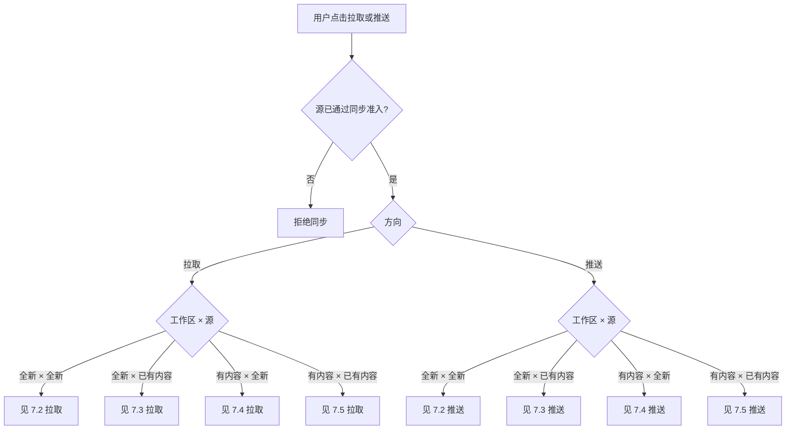
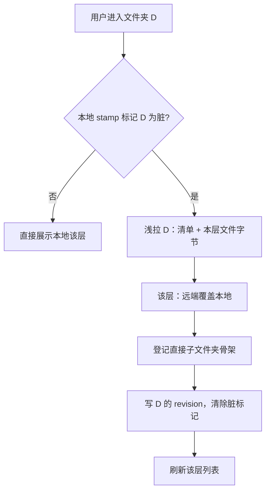
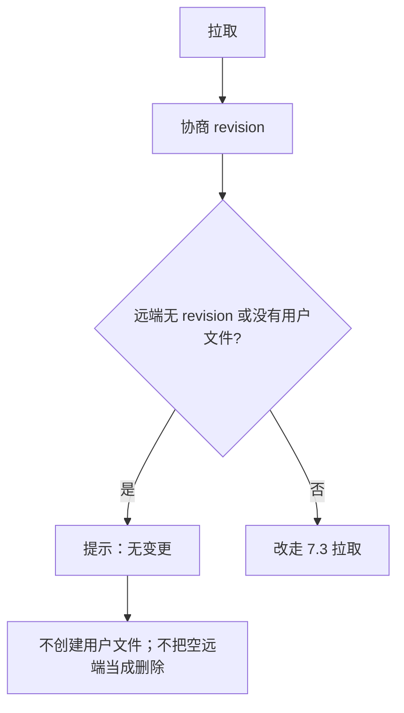
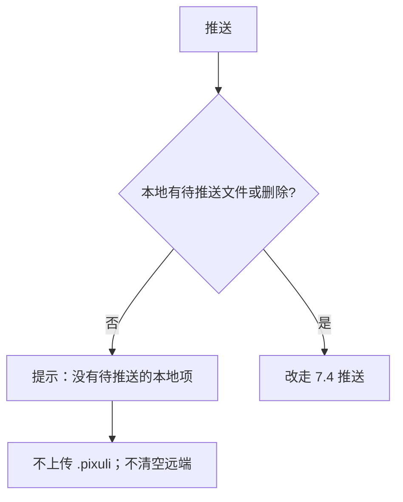
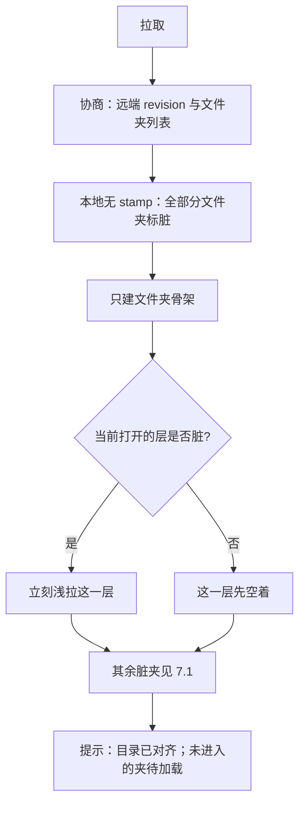
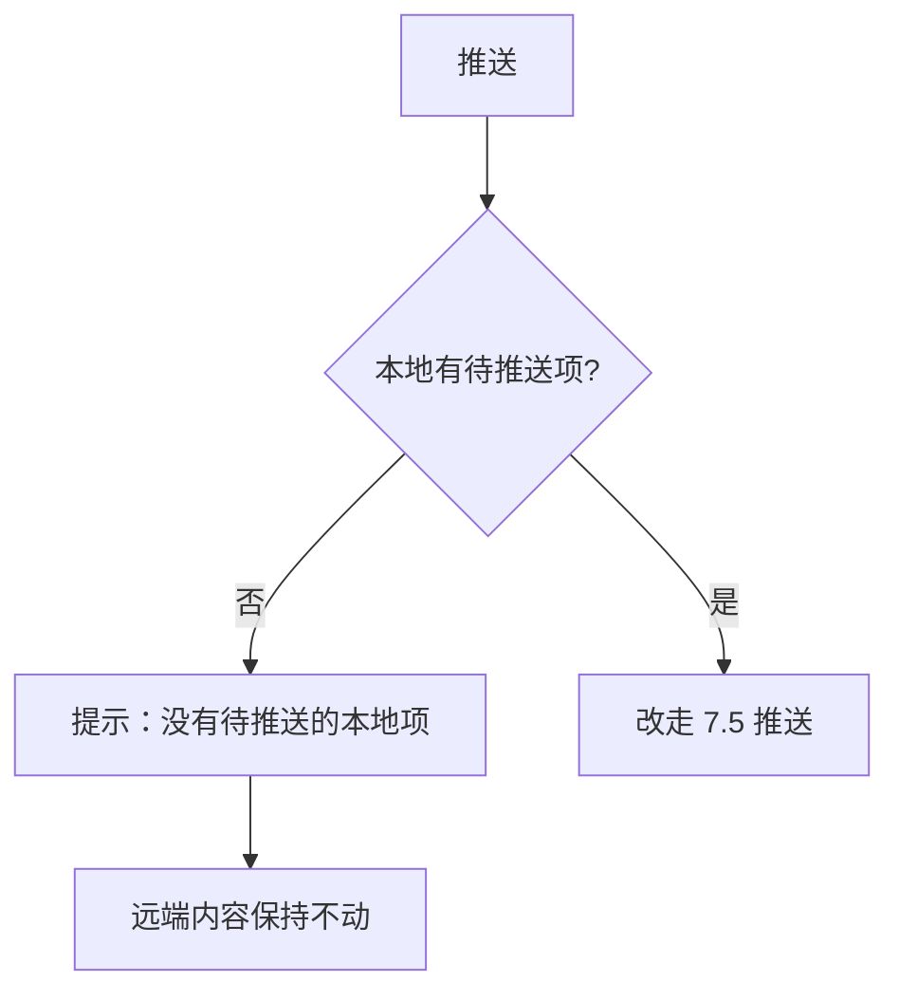
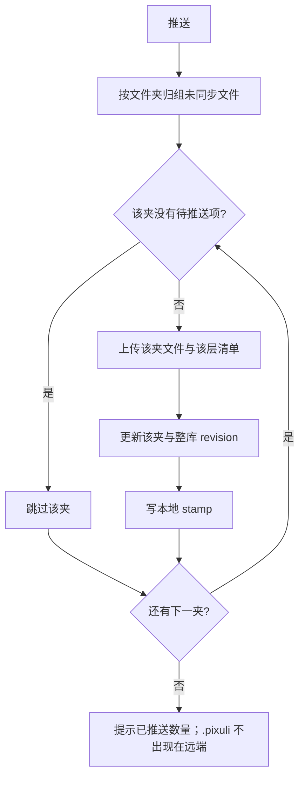
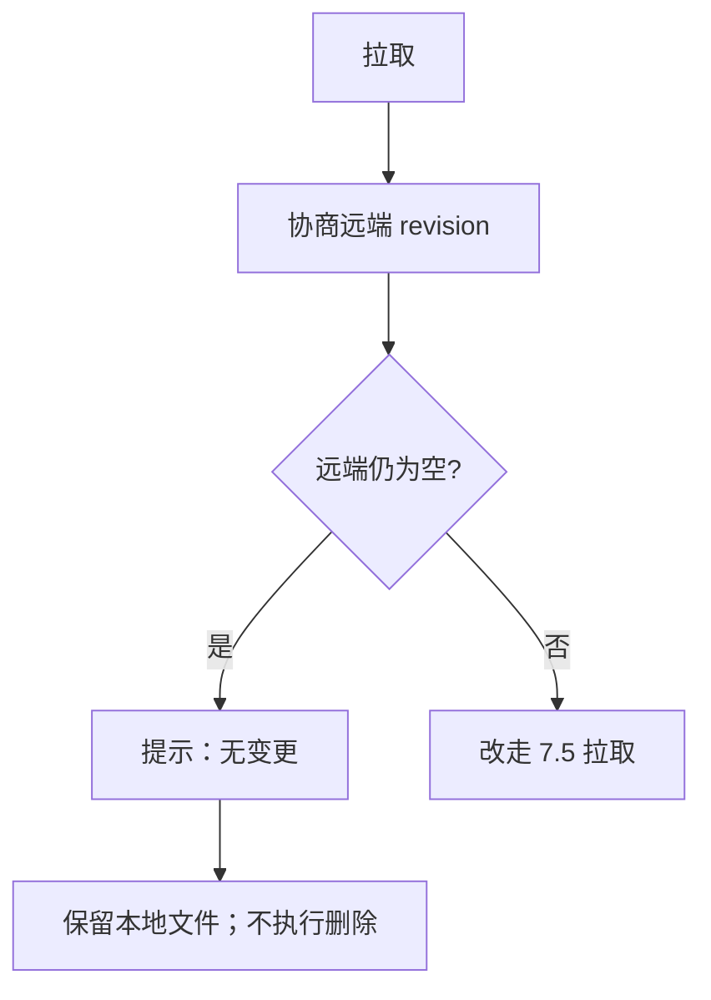
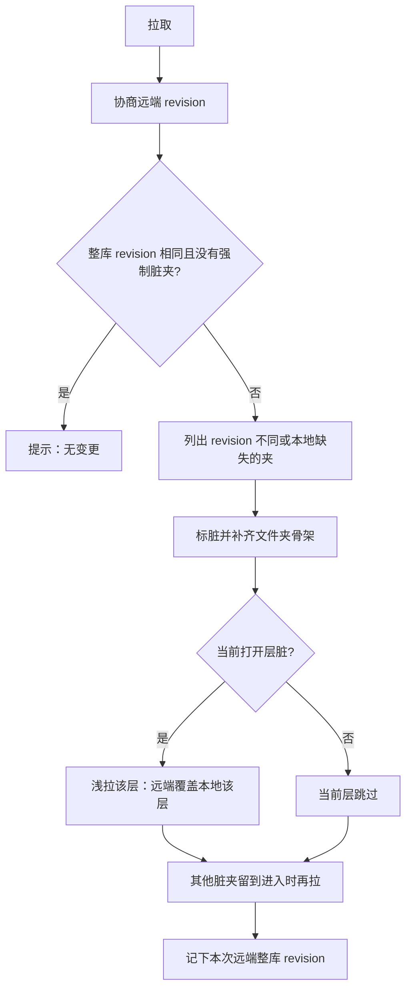
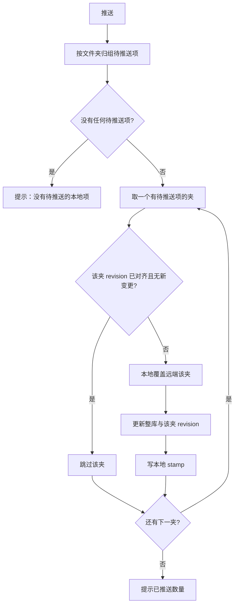

# 本地工作区与远端同步

- **文档版本**：3.0
- **计划**：REF-607 · [#144](https://github.com/trueLoving/Pixuli/issues/144)
- **最后核对**：2026-10-21
- **状态**：现行设计（路径与 Git 族协商已落地；S3 与能力面收敛仍是设计）
- **相关**：[03-plugin-system](./03-plugin-system.md) ·
  [04-asset-library-ui](../01-product/04-asset-library-ui.md) ·
  [03-three-platform-interaction](../01-product/03-three-platform-interaction-spec.md)

> **本地为 SSOT**。远端经已准入的 Provider
> **可选、显式**同步。库内增删改不自动 push。  
> `.pixuli/` 只留本机。协议定义在能力与语义上；Git 的 `sync-tree.json`
> 只是 Git 族的高效落盘，不是所有源的唯一格式。  
> 不考虑旧数据兼容。

| 章节   | 内容                                 |
| ------ | ------------------------------------ |
| 一至二 | 架构、原则、一次同步传什么           |
| 三至四 | 目录、configRoot、manifest、按层浏览 |
| 五     | 源准入、能力面、巨变应对             |
| 六     | Git 族协商缓存                       |
| 七     | 四类场景的拉取 / 推送流程            |
| 八至九 | 三端、实现状态                       |

---

## 一、架构

```text
UI / workspaceStore
        │  pull · push · syncFolder · dirtyScopes
        ▼
SyncEngine（编排能力，不知 Git / S3 API）
        │
StorageProvider（github / gitee / 规划中的 s3）
```

| 组件               | 位置                  | 职责                                               |
| ------------------ | --------------------- | -------------------------------------------------- |
| `WorkspaceAdapter` | `app/src/platforms/*` | 按端读写目录（Electron FS / OPFS·FSA / Capacitor） |
| `LocalVault`       | `@pixuli/core`        | 本地资源与索引                                     |
| `SyncEngine`       | `@pixuli/core`        | 队列、协商、按范围 pull/push                       |
| `workspaceStore`   | app                   | 当前工作区与同步状态                               |
| Provider           | `@pixuli/provider-*`  | 用本源机制兑现能力；公网 URL                       |

| 层          | 稳定什么                               | 可变什么                           |
| ----------- | -------------------------------------- | ---------------------------------- |
| UI / Engine | 同步语义、本地 stamp、脏范围、显式触发 | 不绑定某个远端文件名或某次 HTTP    |
| Provider    | 声明 capability；返回统一结果          | Contents、Git Data、ListObjects 等 |
| 远端落盘    | 按族可选                               | 不升格为全局协议                   |

---

## 二、原则与一次同步的范围

| 原则                  | 说明                                                               |
| --------------------- | ------------------------------------------------------------------ |
| 本地 SSOT             | 列表、搜索、批处理默认读本地                                       |
| Core / Provider 无 UI | 平台 IO 经 Adapter 注入                                            |
| 同步显式              | 用户点同步；与复制链接分离                                         |
| 方向性覆盖            | pull 以远端覆盖约定范围；push 以本地覆盖约定范围；无自动 merge     |
| 不上云                | `.pixuli/`（索引、binding、token、队列、本机路径）永不作为同步载荷 |
| 有条件接入            | 不是所有能存文件的源都开 sync；见第五节                            |
| Gitee 图床            | 无 Host 图片代理；分享走 `buildPublicUrl`                          |

**一次点击同步的范围：**

- **协商整库**：先比对全部文件夹的 revision，决定哪些夹脏了。
- **推送整库待推送项**：不限当前文件夹；已同步且未改的文件跳过。
- **拉取文件字节只覆盖当前打开的那一层**（直接文件，不含子夹里的文件）。其余脏夹进目录再拉。

主按钮表示「这个库和远端对齐了没有」。若以后要「只同步这一夹」，做成次要操作。

用户选「双向」时：先推送，再拉取。后一步不会把刚推上去、revision 已对齐的文件夹再标脏。

安全约定：

- 空工作区去推送：没有待推送项就结束，**不**清空远端。
- 空源来拉取：没有远端变更集就结束，**不**删除只存在于本地、且从未从该源同步过的文件。
- 同一夹两边都改过：点拉取则该夹以远端为准，点推送则以本地为准。希望保留远端修改时，先拉再推。

---

## 三、目录与 configRoot

### 3.1 本地目录

```text
{vault}/
  …用户文件/文件夹…
  .pixuli/
    config.json
    index…
    folders.json          # 显式空文件夹；仅本地
    sync/state.json       # binding 维度的 stamp
```

空文件夹靠 `.pixuli/folders.json`
登记。文件夹新建、重命名、删除只改本机，不自动同步远端。

### 3.2 configRoot：路径 1:1

数据源配置里的挂载点子目录。本地相对路径与远端的关系：

```text
远端完整路径 = configRoot + '/' + 本地工作区相对路径
```

`configRoot` 为空时挂在仓库根或桶前缀根上，实现时去掉首尾 `/`。

configRoot = `root` 时：

```text
本地工作区                         远端
├── .pixuli/          ✗ 不同步
├── .metadata/        ✓          →  root/.metadata/…
├── images/1.png      ✓          →  root/images/1.png
├── images/trip/a.jpg ✓          →  root/images/trip/a.jpg
└── video/1.mp4       ✓          →  root/video/1.mp4
```

`images` 只是普通文件夹，不是同步边界。不维护 `localPathPrefix` /
`remotePathPrefix` 两套字段。`syncPush` / `syncPull` 的 `remotePath`
就是工作区相对路径；Provider 内部 `join(configRoot, relativePath)`。

|          | 旧 `config.path = images` | configRoot                  |
| -------- | ------------------------- | --------------------------- |
| 语义     | 资源必须落在 `images/` 下 | 整个用户目录树镜像到挂载点  |
| 同级目录 | 易被摊平进 `images/`      | `video/1.mp4` 仍在 `video/` |

早期扁平路径（丢子目录、按 basename 对账）已废弃。

### 3.3 同步边界

| 路径                       | 是否同步 | 说明                         |
| -------------------------- | -------- | ---------------------------- |
| `.pixuli/`                 | 否       | 配置、索引、队列、stamp      |
| `.metadata/`（含各目录下） | 是       | 多端 pull 还原展示名、标签等 |
| 用户文件与文件夹           | 是       | 相对工作区根 1:1 映射        |

---

## 四、元数据与按层浏览

每个目录一份 manifest，只描述**本层直接文件**。

```text
images/
├── .metadata/manifest.json
├── 1.png
└── trip/
    ├── .metadata/manifest.json
    └── a.jpg
```

```json
{
  "version": 1,
  "files": {
    "1.png": {
      "name": "1.png",
      "tags": ["demo"],
      "description": "",
      "width": 800,
      "height": 600,
      "size": 12345,
      "type": "image/png",
      "createdAt": "2026-08-31T00:00:00.000Z",
      "updatedAt": "2026-08-31T00:00:00.000Z"
    }
  }
}
```

| 规则         | 说明                                                    |
| ------------ | ------------------------------------------------------- |
| key          | 本层文件名，层内唯一                                    |
| 读写         | 浏览某目录：一次列举 + 一次读 manifest                  |
| 不同步的形态 | 全库一份超大 JSON；按 basename 扁平 sidecar（同名会撞） |

选中目录时，左侧树保持嵌套，右侧网格只显示该层直接文件。可选在网格放子文件夹卡片，点击等价于选中子目录。文件夹树隐藏
`.metadata`。

| UI                   | Metadata                         |
| -------------------- | -------------------------------- |
| 选中 `D`             | 读 `D/.metadata/manifest.json`   |
| 只显示 `D/` 本层文件 | manifest 只含本层条目            |
| 进入 `D/b/`          | 读 `D/b/.metadata/manifest.json` |

S3 等源可以改用旁路 index 对象，只要对 Engine 仍是「按层清单」。UI 不判断远端有没有某个固定文件名。

---

## 五、源准入与能力面

官方参考集是
**GitHub、Gitee、S3**。其它源默认不开 sync，个案审核。网盘类源若以后接入，须过本节，并用各自的增量或清单机制兑现协商，不必伪造
`sync-tree.json`。

达不到门槛的源只做浏览或导入。

### 5.1 为什么要审核

1. 把某种协商文件写死进 Engine 后，换源就要改 core。
2. UI 知道 Contents 或 ListObjects 后，源一变就要改 app。
3. 只有上传、没有可靠列举或 revision 时，无法「无变更跳过」。

### 5.2 参考源

| 维度     | GitHub / Gitee                        | S3 兼容                          |
| -------- | ------------------------------------- | -------------------------------- |
| 变更发现 | 树 SHA、`sync-tree.json` 或 blob 列表 | ListObjects + ETag；可选清单对象 |
| 按层列举 | Contents 非递归                       | `prefix` + `delimiter=/`         |
| 批量写入 | Git Data 一次 commit，或逐文件        | PutObject / DeleteObjects        |
| 鉴权读   | 带 token 的 Contents                  | SigV4 GetObject                  |
| 公网链   | raw / pages                           | 公网桶或预签名（可选）           |
| 元数据   | `{dir}/.metadata/manifest.json`       | 同路径对象或旁路 index           |

| 源     | 定位               | 高效机制                               |
| ------ | ------------------ | -------------------------------------- |
| GitHub | 已定官方 sync 源   | sync-tree + 浅层文件夹 + 可选 Git Data |
| Gitee  | 已定官方 sync 源   | 与 GitHub 同族，API 差异留在 provider  |
| S3     | 规划中的第三参考源 | 前缀浅列 + ETag / 清单 revision        |
| 其他   | 默认不接入         | 须映射到 5.4 的能力                    |

### 5.3 硬门槛

宣称可 sync 时，H1–H11 都要满足。接入说明里逐条写「如何满足」和降级路径。

| #   | 条件           | 说明                                              |
| --- | -------------- | ------------------------------------------------- |
| H1  | 路径可逆镜像   | 工作区相对路径与远端键 1:1；禁止静默摊平          |
| H2  | `.pixuli` 隔离 | 索引、binding、token、队列不上云；列举可排除      |
| H3  | 可读写删       | 创建/覆盖、读字节、删除（或 pull 能看见的墓碑）   |
| H4  | 可列举         | 至少能列一层，或给出增量变更集                    |
| H5  | 方向性覆盖     | 见第二节；无隐式双向 merge                        |
| H6  | 可协商         | 稳定 cursor / revision，无变更时几乎不传文件字节  |
| H7  | 可划范围       | 变更能变成文件夹或路径 scope，以便懒加载          |
| H8  | 鉴权下载       | 不依赖仅公网裸链                                  |
| H9  | 插件边界       | `@pixuli/provider-*`，不依赖 UI，经 Registry 创建 |
| H10 | 凭据本机       | token 不进远端 tree，不进同步队列明文             |
| H11 | 可测           | 无变更跳过、单 scope 只传该范围、排除 `.pixuli`   |

### 5.4 软能力

硬门槛保证正确，软能力决定效率。Engine 按声明选路，缺了就降级。

| 能力                 | 语义                   | Git 族               | S3 族            |
| -------------------- | ---------------------- | -------------------- | ---------------- |
| `sync.negotiate`     | 先协商再决定是否传字节 | sync-tree / tree SHA | 清单 ETag        |
| `sync.shallowFolder` | 只列/拉某一层          | Contents + shallow   | delimiter=/      |
| `sync.delta`         | 相对 cursor 的变更集   | compare（弱）        | 版本或 changelog |
| `sync.batchWrite`    | 一批一次提交           | Git Data             | DeleteObjects    |
| `sync.contentHash`   | 未变文件跳过字节       | blob SHA             | ETag             |
| `publicUrl`          | 稳定公网读链（可选）   | raw / pages          | 公网桶或 CDN     |

选择顺序：

1. 有 `negotiate`：未变则跳过。
2. 脏范围是文件夹且有 `shallowFolder`：当前层立刻拉，其余进夹再拉。
3. 只有 `delta`：应用变更集，必要时收成文件夹 scope。
4. 都没有：全量 `syncPull`（正确，但慢）。

本地 stamp 永远在
`.pixuli/sync/state.json`。远端 stamp 的形状由 provider 决定。Engine 只认：

```text
Negotiate → unchanged(cursor) | dirty(cursor, scopes[])
Pull(scope, { shallow? }) → items[] + childScopes? + nextCursor?
Push(items[]) → 成功后由 provider 更新远端 revision
```

| 用户看到的               | 含义                          |
| ------------------------ | ----------------------------- |
| 无变更                   | unchanged                     |
| 若干文件夹待进入后再拉取 | dirty scope 还没拉字节        |
| 进夹后出现文件           | 懒拉该层                      |
| 已推送                   | 本地 stamp 与远端 cursor 对齐 |

### 5.5 底层巨变

| 变化                         | 应对                             | 谁改                 |
| ---------------------------- | -------------------------------- | -------------------- |
| 同一源换 API                 | provider 内换实现，结果形状不变  | 对应 provider        |
| 协商载体更换                 | provider 读写新载体，可短暂双读  | 对应 provider        |
| 新增同源（Gitea、R2、MinIO） | 复用 Git 族或 S3 族              | 新 provider + 准入   |
| 能力增减                     | 更新 manifest；Engine 降级或升级 | core 策略 + provider |
| 不再满足硬门槛               | 撤销 sync，或只保留浏览          | 产品 + manifest      |

不变的底线：本地 SSOT、`.pixuli`
不上云、显式同步、方向性覆盖、core/provider 无 UI。

演进时：manifest 可带
`syncContractVersion`；未知能力忽略，缺硬能力则拒绝 sync。Git 族、S3 族各自共享 helper。每个官方 sync 源跑同一组语义测试（跳过、单 scope、排除
`.pixuli`）。

现行 `readSyncTree` 是 Git 族可选实现。后续接口宜收敛成 negotiate + 按 scope
pull。

---

## 六、Git 族协商缓存

本节只描述 GitHub / Gitee 的默认落盘。S3 用清单 ETag 等兑现同一语义。

| 远端                                    | 作用                                           |
| --------------------------------------- | ---------------------------------------------- |
| `{configRoot}/.metadata/sync-tree.json` | 整库 revision + 每夹 `{ revision, updatedAt }` |
| `{dir}/.metadata/manifest.json`         | 该层文件清单                                   |

本地：`.pixuli/sync/state.json` 里该 binding 的 `treeRevision` 与
`folders[key].{ revision, dirty }`。

1. 拉取先读 sync-tree；与本地 stamp 相同则跳过文件字节。
2. 有差异则标脏；立刻浅拉当前层；其余进夹再 `syncFolder`。
3. 推送按文件夹归组待推送项；有变则覆盖该层并更新该夹与整库 revision；成功后写本地 stamp。

---

## 七、同步流程

### 7.0 判定

| 状态           | 判定                                            |
| -------------- | ----------------------------------------------- |
| 全新工作区     | 无用户文件，且该 binding 无本地 stamp           |
| 有内容的工作区 | 索引里已有用户文件，或有待推送队列              |
| 全新的源       | 没有可协商 revision，或 revision 下没有用户文件 |
| 已有内容的源   | 协商得到 revision，且至少有一个文件夹或文件     |



### 7.1 进文件夹懒加载

拉取只保证当前层立刻有文件。其余脏夹等用户进入。



子夹若仍脏，要再进入才拉文件。

### 7.2 全新工作区 × 全新的源

两边都没有用户文件。





### 7.3 全新工作区 × 已有内容的源

拉取先看见文件夹树，进夹才下文件。推送不能因为本地是空的就清远端。





### 7.4 有内容的工作区 × 全新的源

推送是首次上云。拉取不误删本地。



远端还没有 revision，含文件的夹都要上传，不能按「与上次远端 revision 相同」跳过。



### 7.5 有内容的工作区 × 已有内容的源



该层覆盖：远端有的文件写入本地；远端清单已删除、且本地曾同步过的文件做本地删除。未同步、且不在该远端清单里的本地新文件留在待推送队列，不因别的夹变了而被删。



只改某一个夹时，其它夹不传文件，只更新整库 revision 里这一夹的标记。

### 7.6 对照

| 工作区 \ 源    | 全新的源                                   | 已有内容的源                                 |
| -------------- | ------------------------------------------ | -------------------------------------------- |
| 全新工作区     | 拉取、推送都无变更                         | 拉取：建树 + 当前层 + 懒加载；推送：不动远端 |
| 有内容的工作区 | 推送：按夹首次上传；拉取：无变更且不删本地 | 拉取：脏夹远端覆盖；推送：有变更的夹本地覆盖 |

---

## 八、三端与验收

| 端      | Adapter                                       |
| ------- | --------------------------------------------- |
| Desktop | Electron 选目录 + 真实 FS                     |
| Web     | File System Access / OPFS；能力不足则降级说明 |
| Mobile  | Capacitor；与 Web 共用 UI                     |

已交付口径：可打开本地工作区并浏览；连接 GitHub/Gitee 后可手动 sync；公网链接不依赖已退役的 Gitee 图片 Host 代理；core/provider 无 UI 依赖。

断点续传属于 Provider，不是库内删改路径。分阶段历史以 REF-607（#144）为准。

---

## 九、实现状态

已落地：

- configRoot：工作区相对路径与远端 1:1；排除 `.pixuli/`。
- 各目录 `{dir}/.metadata/manifest.json`（GitHub / Gitee）。
- 文件夹协商：`sync-tree.json`、本地 per-folder
  stamp、`syncPull({ pathPrefix, shallow })`、进夹懒加载。
- 一次同步：推送全部待推送项；拉取字节为当前层。

仍可选或未做：

- 网格中的子文件夹卡片；文件夹树隐藏 `.metadata`。
- 配置项文案改为「远端挂载目录 (configRoot)」。
- S3 按第五节准入后接入。
- Engine 从「可选 readSyncTree」收敛为 negotiate + 按 scope pull。

底线不动：`.pixuli/`
不上云；core/provider 不依赖 UI；用户显式同步；后台不全库静默 pull。

---

## 十、修订

| 版本 | 日期       | 说明                                                     |
| ---- | ---------- | -------------------------------------------------------- |
| 3.0  | 2026-10-21 | 合并原 04 / 06 / 07 / 08：路径、准入、流程、一次同步范围 |
| 2.1  | 2026-10-20 | 文件夹协商缓存；`.pixuli` 不上云                         |
| 2.0  | 2026-08-25 | 瘦身为现行架构摘要                                       |
| 1.0  | 2026-06-11 | REF-607 设计稿                                           |
